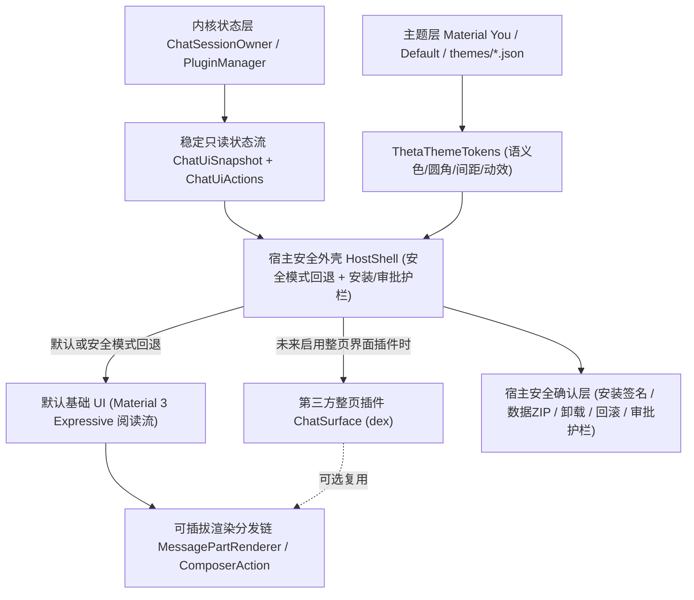

# Theta UI 设计规范与插件 UI 扩展架构

> 状态：暂定基线 v0.1（2026-11-26，后续可随真机日常试用继续微调）。  
> 关联文档：[DESIGN.md](DESIGN.md)、[PROTOCOL.md](PROTOCOL.md)、[PLUGIN_API.md](PLUGIN_API.md)、[theta-icon.svg](theta-icon.svg)。

## 1. 设计目标与视觉方向

Theta 的 UI 采用**克制版 Material 3 Expressive + 现代 AI 阅读流**风格，兼顾日常高信息密度对话效率与未来插件生态的深度可自定义能力：

1. **原生现代质感（零重依赖）**
   - 直接基于仓库已锁定的 `compose-bom = 2026.09.00`（Material 3 + `surfaceContainer*` 分层容器 + `ModalNavigationDrawer` + `ModalBottomSheet` + `MotionScheme.expressive()` 弹簧物理动效），遵循系统「减弱动画」无障碍设置。
   - 图标优先采用轻量 Android Vector Drawable（`res/drawable/ic_*.xml`）或 `material-icons-core`，**禁止引入体积庞大的 `material-icons-extended`**；不引入 WebView。
2. **品牌识别（取自 [theta-icon.svg](theta-icon.svg)）**
   - 吉祥物「探头团子」：钴蓝 `#315DCE` 底色、白色圆润剪影与双竖椭圆眼、顶部暖金 `#FFC94D` 天线光点。
   - **默认动态取色 + 品牌默认色板**：Android 13+ 默认支持 Material You 动态取色，同时内置「Theta 品牌默认色」供一键切换（也是不支持动态取色时的回退色板）：
     - 主色 `primary`：`#315DCE`（浅色）/ 柔和钴蓝提亮阶（深色）；
     - 品牌点缀 `brandAccent`：`#FFC94D`（仅用于空态插画与极细微状态点缀，绝不作为正文文字色）；
     - 浅色画布：暖灰白 `#FAF9F7`（底面）、`#F1F3F8`（`surfaceContainer` 卡片/输入栏）、`#E8EEFA`（用户消息胶囊）；
     - 深色画布：OLED 友好炭灰 `#121316`（底面）、`#1C1F26` / `#242832`（`surfaceContainer` 分层卡片），避免刺眼纯黑与生硬高对比边框。
3. **双语与工程红线**
   - 所有宿主可见文案（含按钮标签、图标 `contentDescription`、错误与占位提示）必须全部落入 `app/src/main/res/values/strings.xml` 与 `values-zh/strings.xml`，并通过 `:app:verifyUiResources`。
   - 业务 Composable **禁止硬编码 `Color(0xFF...)`**，全部颜色、圆角与间距通过 `ThetaThemeTokens` 统一读取。

---

## 2. 面向「插件 UI」的解耦架构与 3 条安全底线

Theta 的内核状态（`agent-core` / `ChatSessionOwner` / `PluginManager`）本就与 UI 解耦，且 dex 插件共享宿主的 Compose 与 Material 3。基础 UI 从第一天起就按**三层解耦契约**落地，为后续从「零代码皮肤包」演进到「整页替换聊天视图」铺路：

### 2.1 三条不可让渡的宿主安全底线

即使未来允许第三方插件深度定制甚至整页替换聊天界面，以下 **3 类宿主安全壳** 始终由宿主固定渲染与兜底，绝不由外部主题包或界面插件接管或隐藏：

1. **冷启动安全模式与崩溃救援回退**：按 [DESIGN.md](DESIGN.md) §7，Compose 组合期异常不可 `try/catch`。一旦第三方 `ChatSurface` 崩溃触发连续崩溃保护，冷启动必须自动回退到宿主内置 `DefaultChatSurface` 并隔离嫌疑插件，保证 App 永不变砖。
2. **插件安装签名确认 / 数据 ZIP 确认 / 卸载 / 回滚弹窗**：固定由宿主 `MainActivity` 顶层安全壳渲染，防止异常 UI 隐藏证书指纹、目标域名或不可逆风险说明。
3. **工具审批与未知副作用核对护栏**：待审批调用（`showApproval(record)`）与未知副作用/恢复卡片（`effect == UNKNOWN` / `recoveryPending` / `ChatRecoveryCard`）必须自动展开且保持高对比度可见；未来数据主题包加载时强制校验最小对比度且**禁止覆写错误/危险警示色**。

### 2.2 内部抽象先行、SDK 延后冻结

- 在 **UI-1** 阶段先在 `app/` 内部建立 `ThetaTheme`、`ThetaThemeTokens`（经 `CompositionLocalProvider` 下发，同时包装标准 `MaterialTheme` 使现有第三方 `SettingsPage` 自动继承）以及只读 `ChatUiSnapshot` + `ChatUiActions`。
- 待基础 UI 经真机日常使用打磨稳定后，再在后续阶段按 [DESIGN.md](DESIGN.md) §8 规则（**公开 API 不用 `data class`、接口方法带默认实现、纯增量向后兼容**）提炼发布为 SDK API Level 2 扩展点。

---

## 3. 核心界面规范

### 3.1 聊天主页（`ChatScreen` — UI-1）

彻底移除当前堆叠在顶部的 6–7 个 `TextButton` 行，转为极简现代 AI 阅读流：

1. **单行极简 `TopAppBar`**
   - **左侧**：汉堡菜单图标按钮（打开左侧会话抽屉；必须提供双语 `contentDescription`，如 `Open navigation menu` / `打开导航菜单`）；
   - **中间**：可点击圆角模型胶囊，展示当前激活对话模型名称（沿用 `#159` 去重规则，避免 `name · modelId` 重复拼接；若启用了非默认 Persona，可附精简副标签或角标），点击弹出半屏模型/人设切换 `ModalBottomSheet`；未配置模型时直接跳转模型服务商设置；
   - **右侧**：新建会话图标按钮（运行中或加载中禁用）。
2. **全自动模式高对比度警示条**
   - 仅当 `ApprovalMode.FULL_AUTO` 时紧贴顶栏下方展示（`errorContainer` / `onErrorContainer`），提供一键「切回省心模式」与跳转审批权限设置。
3. **现代 AI 阅读流（`LazyColumn`）**
   - **用户消息**：右对齐紧凑圆角胶囊（`userBubbleContainer`），内嵌已发送图片缩略图（支持点击预览与长按复制文本）；
   - **助手回复**：**左对齐无边框全宽排版**，直接复用 `#156` 纯 Compose Markdown 渲染（流式输出按帧合批，无闪烁、可选中复制、围栏代码块横向滚动 + 一键复制）；
   - **思考过程（`ContentPart.Reasoning`）**：默认折叠为单行可点击微胶囊（展示思考状态/摘要入口），点击展开弱化字色正文；
   - **工具调用（`ContentPart.ToolCall`）**：
     - 常规态（等待/运行中/已完成/已拒绝/已取消/失败）收敛为紧凑单行胶囊（显示工具来源/名称与状态，点击展开参数、进度与结果摘要）；
     - **待审批（`showApproval(record)`）与未知副作用待核对（`effect == UNKNOWN` / `recoveryPending`）自动展开为高对比度 `OutlinedCard`**，清晰展示风险徽标、摘要与全部操作按钮，绝不折叠隐藏。
   - **空会话欢迎页**：居中展示「探头团子」矢量标识 + 简短双语欢迎语 + 2–3 个轻量引导操作胶囊（例如未配置模型时直达模型设置、已配置时提供轻量对话建议或快速入口）。
   - **完整保留既有状态与恢复能力**：加载进度条、`state.error`、`personaUnavailable` / `personaRecovered`、历史分页（`older` / `latest`）、保留回复日志（`journal` / `olderJournal`）、`ChatRecoveryCard`、`ChatDiagnostics`、`continueSavedStep`（完成已保存步骤）与 `#157` 断链保活提示均完整保留且不丢失功能。
4. **悬浮整合输入栏（兼顾竖屏、横屏与分屏 `#158`）**
   - 已选待发送图片缩略图条紧贴输入框内顶部展示（可单张移除）；
   - 单条圆角容器整合：左 `+` 按钮（弹出紧凑附件菜单：相册选图 / 拍照，预留未来 `ComposerAction` 槽位）、中多行自适应输入框、右圆形主色发送/停止按钮（`state.active || state.pending` 时切为停止按钮）。
   - 旋转屏幕、横屏与分屏下保持消息列表占据主要可视高度，草稿与已选图片不丢失。

### 3.2 左侧导航抽屉与半屏快捷切换（UI-1）

1. **左侧 `ModalNavigationDrawer`**
   - **顶部**：Theta 品牌标识与名称 + 会话搜索框（按标题/预览本地过滤） + `+ 新建对话` 强调按钮；
   - **中部**：按时间分组（今天 / 昨天 / 更早）的会话列表，高亮当前会话，支持删除会话（带二次确认，运行中/待处理时禁用）；
   - **底部固定区**：
     - `Plugins and diagnostics`（`R.string.chat_plugins`，可附已启用插件计数角标）——直达扩展与插件页；
     - `Settings`（设置中心入口）——在 UI-1 阶段先承接当前模型设置/审批/MCP/语言等入口，并在 UI-2 升级为完整全屏设置中心。
2. **底部 `ModalBottomSheet`（模型与人设切换）**
   - **顶部**：人设（Personas）横向单选胶囊条（兼容 `#134`）；
   - **中部**：按 `#159` v3 服务商分组的已启用对话模型列表，严格保持 `#159` 串行持久化落盘锁与失败可重试双语提示；
   - **底部**：当前审批模式状态与快捷入口 + 「管理模型服务商」跳转按钮。

### 3.3 全屏设置中心（`SettingsScreen` — UI-2）

彻底替换当前巨型 `AlertDialog` 堆叠，采用 M3 Expressive 分组圆角卡片列表 + 独立全屏二级页（统一支持系统返回键 `BackHandler` 与大字/横屏纵向滚动）：

| 一级分组 | 设置项 | 对应二级全屏页 / 能力来源 |
| --- | --- | --- |
| **模型与智能体** | 模型服务商与槽位绑定 | 迁入 `ProviderScreen` 全屏页（`#159` + `#154` + `#155`） |
| | 人设与技能 | 迁入人设与技能配置全屏页（`#134`） |
| | MCP 工具源 | 迁入 Streamable HTTP MCP 管理全屏页（`#136`） |
| **安全与权限** | 审批模式与工具权限管理 | 迁入三档审批、Root 长期开关、永久授权撤销、拒绝规则与风险上调全屏页（`#137` + `#153`） |
| **界面与自定义** | 外观与主题 | 深浅色模式（跟随系统 / 浅色 / 深色）、动态取色开关（Material You / Theta 品牌默认色），并持久化偏好；预留「主题皮肤包」与「聊天界面插件」扩展位 |
| **系统与诊断** | 界面语言 | 迁入应用语言切换（跟随系统 / English / 中文，复用既有语言切换逻辑） |
| | 后台运行与保活诊断 | 迁入国产 ROM 后台保活检测与安全跳转页（`#157`） |

### 3.4 扩展与插件页（`PluginsScreen` — UI-3）

将 `MainActivity.kt` 中扁平堆叠的 `PluginList` 升级为结构清晰的 Material 3 全屏管理页，同时**严格守住 S1/S2 自动化设备验收契约**：

1. **视觉与信息层级**
   - 顶栏：返回按钮 + 「扩展与插件」标题 + API 等级副标题；
   - 顶部紧凑导入操作条：保留清晰可达的 `Import code APK` 与 `Import data ZIP` 按钮（支持取消读取与重试清理）；
   - 轻量分段筛选标签：`All`（默认选中）/ `Code` / `Data` / `Environment & Hook`；
   - 顶部可折叠「设备运行环境摘要卡片」（无障碍 / Shizuku / Root / LSPosed 状态 + 刷新与快捷跳转）；
   - 数据插件与代码插件分别使用 M3 圆角卡片呈现：名称与版本、状态徽标、紧凑能力标签（`免 Root` 等）、操作按钮行、已展开工具/页面/Entry 状态；
   - 底部仅保留一次免责提示（保持 PR #147 去重成果）与 Hook 诊断折叠卡片。
2. **S1/S2 自动化回归脚本兼容性红线（强制遵守）**
   - `scripts/emulator-test.py`、`scripts/lifecycle-acceptance.py` 与受保护的 `scripts/verify-signatures.sh`（调用 `scripts/signature-acceptance.py`）依赖 `uiautomator` 节点文本匹配：
     - **UI-1 导航同步**：将 `Plugins and diagnostics` 移入左侧抽屉后，UI-1 必须同步更新 `scripts/emulator-test.py`、`scripts/lifecycle-acceptance.py` 与 `scripts/acceptance-observation-test.py` 的入口打开辅助函数（先查屏幕是否已有 `Plugins and diagnostics`，否则通过抽屉菜单图标 `content-desc` 打开抽屉再点击 `Plugins and diagnostics`），并确保恢复模式（`--ez skip_plugins true`）继续直达插件恢复界面。
     - **UI-3 默认视图可达性**：插件页默认停留在 `All` 标签，主列表保持单一 `scrollable="true"` 纵向容器，保证以下英文精确文本节点在默认视图下**唯一且滚屏可达**（避免重复文本触发 `require(len(matches) <= 1)` 失败）：
       - `Import code APK`、`Import data ZIP`、`Code packages`、`Data packages`、`No plugins installed`、`No selected data packages`
       - `Disable <name>` / `Enable <name>` / `Uninstall <name>` / `Roll back <name>` / `Clear-data uninstall <id>`
       - `Disable data` / `Enable data` / `Uninstall data` / `View data content`
       - 所有安装/卸载/回滚确认弹窗按钮文本（`Code APK`、`Data ZIP`、`Install`、`Confirm uninstall`、`Delete package and data`、`Confirm rollback`、`Confirm this ZIP`）保持零变更。

---

## 4. 插件 UI 扩展路线（后续阶段：UI-4 与 UI-5）

基础 UI（UI-1 ~ UI-3）合入并在真机日常使用验证稳定后，按以下两步开放插件 UI 生态：

### 4.1 UI-4（L1 · 数据插件零代码主题皮肤包）
- 在数据插件目录规范中新增可选 `themes/<id>.json`（纯声明式数据，无可执行代码）：
  - 字段：`id`、`displayName`、`useDynamicColor`、`light` / `dark` 语义色覆盖、`cornerScale`、`messageStyle`（`"editorial" | "bubble" | "compact"`）。
- 加载校验：严格解析十六进制色值与有限枚举，执行 WCAG 最低文本对比度检查，**禁止覆盖安全/错误警示色**，单条损坏 fail-closed 隔离；停用或卸载数据插件立即回退默认主题。

### 4.2 UI-5（L2 & L3 · SDK API Level 2 局部渲染器与整页聊天视图）
- 遵循 [DESIGN.md](DESIGN.md) §8 二进制兼容约定新增可选扩展点：
  - `MessagePartRenderer : Extension`：按 `toolKey` / `mimeType` / `partKind` 自定义消息或工具结果卡片渲染，未命中回退默认渲染器；
  - `ComposerAction : Extension`：向输入栏 `+` 菜单注册自定义快捷动作；
  - `ChatSurface : Extension`：允许 dex 插件替换主聊天视图，宿主注入只读 `ChatUiSnapshot`、`ChatUiActions` 与受保护的 `ChatHostSlots`（审批卡片、恢复卡片、抽屉与设置入口）；同一时间最多启用 1 个 `ChatSurface`，触发连续崩溃保护时冷启动自动回退 `DefaultChatSurface` 并隔离嫌疑插件。

---

## 5. 分阶段落地排期

1. **UI-1**：主题 Token 体系 + `ChatUiSnapshot`/`ChatUiActions` 内部抽象 + 现代 AI 阅读流 `ChatScreen` + `ModalNavigationDrawer` + 模型/人设 `ModalBottomSheet` + S1 抽屉导航适配。
2. **UI-2**：独立全屏设置中心与全量二级设置页迁移（模型/人设/MCP/审批/外观偏好/语言/保活诊断）。
3. **UI-3**：扩展与插件页 Material 3 改版（默认 `All` 视图 + 分段筛选 + 可折叠环境摘要 + S1/S2 验收全绿）。
4. **UI-4**（基础 UI 稳定后）：L1 `themes/*.json` 数据插件主题皮肤包。
5. **UI-5**（基础 UI 稳定后）：L2/L3 SDK API Level 2 `MessagePartRenderer`、`ComposerAction` 与 `ChatSurface`。
